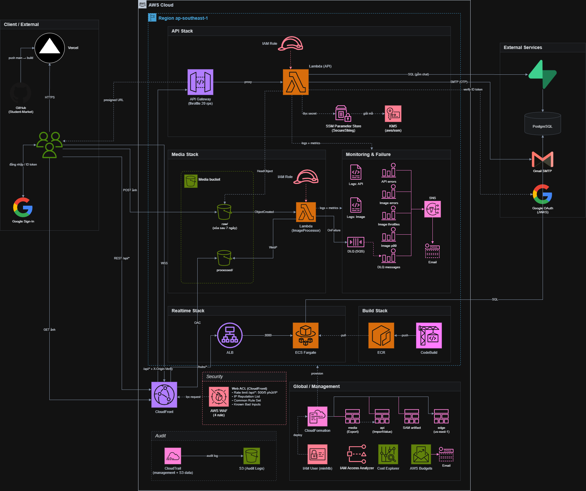

# Student Flea Market
## A Cloud-Native Secondhand Marketplace for Students

### 1. Executive Summary

Student Flea Market (Student Market) is an online marketplace where university students can buy, sell, or exchange textbooks, study materials, electronic devices, dormitory supplies, and other pre-owned items. The project addresses a common problem: listings are often scattered across social networks and chat groups, making them difficult to search, compare, manage, and verify.

The solution combines a responsive Next.js frontend hosted on Vercel, an ASP.NET Core 8 backend running on AWS Lambda, and PostgreSQL on Supabase. The backend provides protected REST APIs, enforces business rules, and issues short-lived presigned requests that allow browsers to upload images directly to Amazon S3. An event-driven Lambda function converts uploaded images into optimized WebP variants, which are delivered through Amazon CloudFront. CloudFront, protected by AWS WAF, is also the single public entry point for the API, while secrets are stored in AWS Systems Manager Parameter Store.

The platform covers registration and login (email/password with OTP verification and Google sign-in), category browsing, search and filtering, seller-owned listings, secure image processing, favorites, exchange requests, transactions, reviews, reports, moderation, and chat. Chat works over REST on Lambda; realtime chat via SignalR runs on an optional ECS Fargate stack that is enabled only for demos.

### 2. Problem Statement

#### Current Problem

Students commonly use social networks, messaging groups, or personal contacts to exchange pre-owned items. This approach has several limitations:

- Posts quickly become buried and cannot be filtered through a consistent structure.
- Descriptions, item condition, prices, and contact details do not follow a common standard.
- Buyers find it difficult to compare products or determine whether an item is still available.
- Sellers do not have a dedicated workflow for managing listings and images.
- Identity verification, ownership control, moderation, and reporting are limited.
- Uploading large images through a traditional API increases application server load and bandwidth usage.

#### Proposed Solution

Student Flea Market provides a centralized platform where students can register, sign in, browse and filter products, manage listings, upload images securely, save favorites, send exchange requests, track transactions, chat with sellers, leave reviews, and report violations.

The platform follows a cloud-native, cost-aware design. Request-driven components use managed, consumption-based AWS services (Lambda, API Gateway, S3, CloudFront), while PostgreSQL provides transactional consistency for users, products, exchanges, transactions, conversations, reviews, and reports. Components that would consume most of the AWS credit (frontend hosting and the relational database) are placed on free tiers of Vercel and Supabase.

#### Benefits

- **Students:** find suitable products and save money more quickly within a familiar community.
- **Sellers:** use a clear workflow for publishing listings and managing images.
- **Campus community:** encourage the reuse of textbooks and equipment while reducing waste.
- **Administrators:** moderate listings, manage users, categories, and moderators, and handle reports.
- **Development team:** work with a modular system that can be tested using PostgreSQL and LocalStack before deployment to AWS.

### 3. Project Scope

#### Core Scope

1. Account registration, email OTP verification, JWT login with refresh tokens, Google sign-in, and password reset.
2. Product categories and paginated listings.
3. Search and filtering by category.
4. Create, view, update, and delete listings, with ownership checks so that only the seller can modify a listing.
5. Direct image uploads using presigned S3 POST requests and automatic conversion to optimized WebP variants.
6. Favorites, exchange requests, transactions (with payment confirmation), reviews, and violation reports.
7. Buyer–seller chat over REST, with optional realtime delivery through SignalR.
8. Administrative interface: moderation, users, sellers, categories, and moderators.
9. Health checks, structured logging, validation, and consistent error responses.
10. A responsive interface supporting Vietnamese and English, plus policy pages.

#### Extended Scope

Online payment gateways, product recommendations, analytics, and migrating the database to Amazon RDS (if the course requires everything to run on AWS) are left for later phases.

### 4. Solution Architecture

Account-level services: AWS CloudTrail (management events in all Regions), IAM Access Analyzer, AWS Budgets, and Cost Explorer. All AWS resources are defined with AWS SAM/CloudFormation in the `ap-southeast-1` Region, except the WAF web ACL, which must be created in `us-east-1`.

#### API Request Flow

1. The user opens the static Next.js application hosted on Vercel.
2. The frontend calls the API through CloudFront (`/api/*`), where AWS WAF applies rate limiting and managed rules.
3. CloudFront forwards the request to API Gateway with a secret `X-Origin-Verify` header; requests that call API Gateway directly are rejected with 403.
4. API Gateway invokes the ASP.NET Core API as an on-demand Lambda function.
5. At cold start the API loads its secrets from SSM Parameter Store; it then validates the request, verifies the JWT, checks ownership, and reads or writes PostgreSQL through Entity Framework Core and the Supabase transaction pooler.
6. Logs and operational metrics are sent to CloudWatch; alarms notify the team by email through SNS.

HTTP API is suitable because the application needs REST/JSON routing and JWT-bearing requests but not usage plans, API keys, or response transformation. On-demand Lambda fits irregular early-stage traffic and does not require an application server to run when there are no requests. Because API Gateway with Lambda cannot keep long-lived WebSocket connections, realtime SignalR chat runs on a separate, optional ECS Fargate task behind an Application Load Balancer that only accepts traffic from CloudFront.

#### Image Upload and Processing Flow

1. An authenticated seller requests permission to upload an image for a listing.
2. The API validates the seller, listing, MIME type, file size, and number of images.
3. The API returns a short-lived presigned S3 POST policy with a fixed object key.
4. The browser uploads the file directly to the **raw/** prefix of the private S3 bucket.
5. The S3 ObjectCreated event invokes the image-processing Lambda function.
6. Lambda generates **thumbnail.webp** (480px) and **large.webp** (1600px) under the **processed/** prefix.
7. CloudFront reads only processed images through Origin Access Control and caches them near users.
8. Failed events are sent to an encrypted SQS failure queue, and a CloudWatch alarm on queue depth notifies the team.

### 5. Technologies and AWS Services

| Component | Technology or service | Responsibility |
|---|---|---|
| Web interface | Next.js 16, React 19, TypeScript | Responsive marketplace interface |
| UI and state | Tailwind CSS, shadcn/ui, TanStack Query, Zustand | UI, server state, and client state |
| Frontend hosting | Vercel (Hobby) | Static hosting, HTTPS, and Git-based deployments |
| Edge and CDN | Amazon CloudFront with OAC | Image delivery, `/api/*` and `/hubs/*` routing |
| Web protection | AWS WAF | Per-IP rate limit on `/api`, IP reputation, common rule set, known bad inputs |
| Public API | Amazon API Gateway HTTP API | HTTPS entry point, routing, CORS, and throttling |
| Backend | ASP.NET Core 8 on AWS Lambda | Authentication, validation, marketplace logic, ownership, and presigning |
| Relational data | Supabase PostgreSQL (Free, Singapore) | Users, products, transactions, messages, and reports |
| Data access | Entity Framework Core and Npgsql | Migrations, constraints, and queries |
| Media storage | Amazon S3 | Private, versioned, encrypted raw and processed images |
| Media processing | AWS Lambda with Magick.NET | Image validation and WebP generation |
| Secrets | AWS Systems Manager Parameter Store + AWS KMS | SecureString DB connection string, JWT key, SMTP password, origin-verify secret |
| Failure handling | Amazon SQS | Destination for failed image-processing events |
| Alerting | Amazon SNS | Email notifications from CloudWatch alarms |
| Observability | Amazon CloudWatch | Logs, metrics, retention, and alarms |
| Audit and access | AWS CloudTrail, IAM, IAM Access Analyzer | Audit trail, least-privilege roles, external-access findings |
| Realtime chat (optional) | Amazon ECS Fargate, Application Load Balancer | SignalR hub `/hubs/chat` on one ARM64 task |
| Container build (optional) | AWS CodeBuild, Amazon ECR | Build the `linux/arm64` API image on AWS and store it |
| Infrastructure as Code | AWS SAM and CloudFormation | Repeatable stacks: media pipeline, API, edge WAF, realtime, build |
| Cost control | AWS Budgets, Cost Explorer | Track spending against the available credit |
| Local AWS emulation | LocalStack | Low-cost testing of S3 and the image pipeline |

### 6. Data Design

The relational model includes ApplicationUser, Category, Item, ItemImage, Favorite, ExchangeRequest, Transaction, Payment, Conversation, Message, Review, Report, and VerificationCode. Indexes and constraints enforce uniqueness, non-negative prices, valid ratings, ownership relationships, and efficient queries. Images are stored in object storage; the database stores references instead of binary image data.

### 7. Security Design

- Separate the deployment identity from Lambda runtime roles in accordance with least privilege; each Lambda has its own role.
- Protect seller operations with JWTs; the backend obtains the user ID from the verified token.
- Store secrets only in SSM Parameter Store as SecureString (KMS); never in source control, templates, or `appsettings`.
- Expose the API only through CloudFront + WAF; the backend rejects `/api` calls without the correct `X-Origin-Verify` header.
- Keep S3 buckets private, encrypted, protected by Block Public Access, and configured with ACLs disabled.
- Restrict presigned uploads by expiration time, object key, content type, and file size.
- Allow CloudFront OAC to read only processed images.
- Allow the optional ALB to accept traffic only from the CloudFront prefix list with the origin-verify header.
- Restrict CORS to the required HTTPS frontend origins.
- Do not log passwords, tokens, secrets, or complete presigned URLs.
- Use CloudWatch alarms with SNS email to monitor API errors, Lambda failures, throttling, duration, and the failure queue.
- Record management events with CloudTrail and review findings from IAM Access Analyzer.
- Enforce administrative permissions in the backend rather than relying only on the UI.

### 8. Implementation Plan

| Phase | Weeks | Main activities | Deliverables |
|---|---:|---|---|
| Requirements and design | 1–3 | Define the scope, architecture, data model, and API contract | Requirements, diagrams, ERD, and API contract |
| Backend foundation | 4–6 | Clean Architecture, EF Core, Identity/JWT, category and item CRUD | API, validation, tests, and Swagger |
| Frontend and integration | 7–9 | Marketplace UI, authentication state, filtering, API client, and seller workflow | Responsive frontend integrated with the API |
| Media and cloud deployment | 10–11 | Presigned uploads, LocalStack, image Lambda, SAM stacks, Lambda API, Vercel, Supabase, IAM review | Deployed media pipeline and API |
| Security, realtime, and handover | 12 | WAF, SSM secrets, CloudTrail, optional Fargate chat, end-to-end checks, documentation | Test report, runbook, deployment guide, and demo |

### 9. Budget Estimation

The project is a course project funded by **$170 of AWS credit** on the AWS Free account plan; an AWS Budget of $10/month tracks spending. Moving frontend hosting to Vercel and PostgreSQL to Supabase removes the largest fixed costs (Amplify and RDS).

| Item | Estimated cost |
|---|---|
| Lambda, API Gateway, S3, CloudFront, SQS, SNS, CloudWatch, SSM (standard parameters) | ~$0–3/month, mostly within free allowances |
| AWS WAF (1 web ACL, 4 rules; the CloudFront Free plan is not available on the Free account plan) | ~$9/month |
| CloudTrail (single trail, management events) | Free |
| Optional realtime stack (ALB + Fargate + public IPv4) | ~$1.3/day, charged only on days it is enabled for demos |
| Vercel Hobby, Supabase Free | $0 |

Costs are further reduced through LocalStack, short log-retention periods, S3 lifecycle rules, resource tags, AWS Budgets, and tearing down the realtime stack when not in use. Credits are temporary discounts, not a long-term operating budget; if the course requires everything on AWS, the database can move to Amazon RDS by changing only the connection string and VPC parameters.

### 10. Risks and Mitigations

| Risk | Impact | Mitigation |
|---|---|---|
| Low user adoption | High | Pilot with a group of students and prioritize simple posting and search flows |
| Fraudulent listings | High | Ownership rules, reports, moderation, account status, and audit logs |
| Unauthorized access or API abuse | High | JWT, least-privilege IAM, WAF rate limiting, origin-verify header, and negative tests |
| Leaked secrets | High | SSM SecureString, no secrets in code, rotation of the origin-verify secret |
| Malicious image uploads | High | Presigned constraints, MIME/magic-byte checks, limits, re-encoding, and private raw storage |
| Duplicate or failed events | Medium | Idempotent object keys, deterministic output paths, retries, alarms, and SQS |
| Unexpected costs | Medium | Budgets, alarms, lifecycle rules, log retention, and turning off the realtime stack |
| Database interruption (Supabase Free pauses after 7 idle days, no restorable backups) | High | Restore before demos, scheduled access, and regular `pg_dump` backups |
| Runtime end of support (`dotnet8`) | Medium | Plan migration to the `dotnet10` Lambda runtime |
| Excessive scope expansion | Medium | Separate core features from future features and define acceptance criteria |

### 11. Current Implementation Status

The project is deployed to production:

- Next.js frontend on Vercel with authentication, Google sign-in, product search, listing management, chat, policy pages, and an administrative interface;
- ASP.NET Core 8 solution separating API, Application, Domain, Infrastructure, ImageProcessor, and Tests, running on Lambda behind API Gateway;
- PostgreSQL on Supabase with EF Core migrations and the full marketplace domain model;
- presigned S3 uploads and the S3-triggered .NET image processor with CloudFront delivery;
- CloudFront as the API entry point protected by AWS WAF; secrets in SSM Parameter Store; CloudTrail and IAM Access Analyzer enabled;
- optional realtime chat stack (ALB + ECS Fargate, image built by CodeBuild into ECR);
- SAM/CloudFormation templates, LocalStack setup, automated backend tests, and frontend lint/typecheck/static export.

Remaining work: end-to-end testing with real accounts (Google sign-in, image listings, two-user realtime chat), fixing vulnerabilities reported by the ECR image scan, and migrating to the `dotnet10` Lambda runtime.

### 12. Expected Outcomes

- A usable marketplace for the student community.
- Secure authentication and listing-management workflows.
- Direct uploads and optimized image delivery.
- An API protected at the edge with WAF and origin verification.
- A maintainable Clean Architecture backend and typed frontend.
- Reproducible infrastructure and a local cloud emulation environment.
- Operational, security, and cost-control documentation.

### References

- [Amazon API Gateway HTTP APIs](https://docs.aws.amazon.com/apigateway/latest/developerguide/http-api.html)
- [AWS Lambda with ASP.NET Core](https://docs.aws.amazon.com/lambda/latest/dg/csharp-package-asp.html)
- [Amazon S3 presigned URLs](https://docs.aws.amazon.com/AmazonS3/latest/userguide/using-presigned-url.html)
- [CloudFront Origin Access Control](https://docs.aws.amazon.com/AmazonCloudFront/latest/DeveloperGuide/private-content-restricting-access-to-s3.html)
- [AWS WAF Developer Guide](https://docs.aws.amazon.com/waf/latest/developerguide/)
- [AWS Systems Manager Parameter Store](https://docs.aws.amazon.com/systems-manager/latest/userguide/systems-manager-parameter-store.html)
- [Amazon ECS on AWS Fargate](https://docs.aws.amazon.com/AmazonECS/latest/developerguide/AWS_Fargate.html)
- [AWS SAM Developer Guide](https://docs.aws.amazon.com/serverless-application-model/latest/developerguide/)
- [AWS Well-Architected Framework](https://docs.aws.amazon.com/wellarchitected/latest/framework/)
