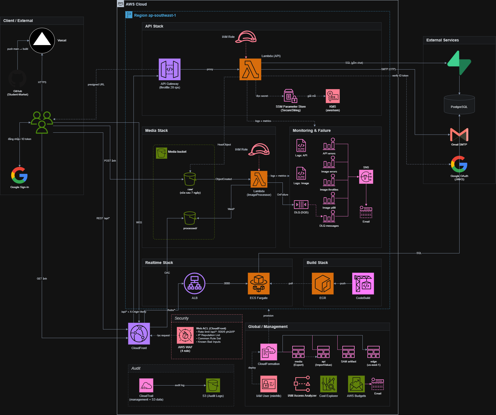

# Student Flea Market
## Nền tảng chợ đồ cũ Cloud-Native dành cho sinh viên

### 1. Tóm tắt 

Student Flea Market (Student Market) là nền tảng chợ trực tuyến dành cho sinh viên đại học mua, bán hoặc trao đổi giáo trình, tài liệu học tập, thiết bị điện tử, đồ dùng ký túc xá và các vật dụng đã qua sử dụng. Dự án giải quyết một vấn đề phổ biến: sản phẩm thường được đăng rải rác trên mạng xã hội và nhóm chat, khiến người dùng khó tìm kiếm, so sánh, quản lý và xác minh độ tin cậy.

Giải pháp kết hợp giao diện Next.js responsive host trên Vercel, backend ASP.NET Core 8 chạy trên AWS Lambda và PostgreSQL trên Supabase. Backend cung cấp REST API có bảo vệ, thực thi quy tắc nghiệp vụ và cấp presigned request có thời hạn ngắn để trình duyệt upload ảnh trực tiếp lên Amazon S3. Một Lambda event-driven xử lý ảnh thành các phiên bản WebP tối ưu và Amazon CloudFront phân phối ảnh đã xử lý. CloudFront, được AWS WAF bảo vệ, cũng là cổng công khai duy nhất của API; secret được lưu trong AWS Systems Manager Parameter Store.

Nền tảng bao gồm đăng ký và đăng nhập (email/mật khẩu có xác minh OTP và đăng nhập Google), duyệt danh mục, tìm kiếm và lọc, tin đăng thuộc sở hữu người bán, xử lý ảnh an toàn, yêu thích, yêu cầu trao đổi, giao dịch, đánh giá, báo cáo, kiểm duyệt và chat. Chat chạy qua REST trên Lambda; chat realtime bằng SignalR chạy trên một stack ECS Fargate tùy chọn, chỉ bật khi demo.

### 2. Vấn đề

#### Vấn đề hiện tại

Sinh viên thường dùng mạng xã hội, nhóm tin nhắn hoặc liên hệ cá nhân để trao đổi đồ cũ. Cách làm này có nhiều hạn chế:

- Bài đăng nhanh chóng bị trôi và không thể lọc theo cấu trúc thống nhất.
- Mô tả, tình trạng, giá và thông tin liên hệ không theo tiêu chuẩn chung.
- Người mua khó so sánh hoặc xác định sản phẩm còn khả dụng hay không.
- Người bán không có quy trình riêng để quản lý tin đăng và hình ảnh.
- Khả năng xác minh danh tính, quyền sở hữu, kiểm duyệt và báo cáo còn hạn chế.
- Upload ảnh lớn qua API truyền thống làm tăng tải và băng thông application server.

#### Giải pháp đề xuất

Student Flea Market cung cấp nền tảng tập trung để sinh viên đăng ký, đăng nhập, duyệt và lọc sản phẩm, quản lý tin đăng, upload ảnh an toàn, lưu yêu thích, gửi yêu cầu trao đổi, theo dõi giao dịch, chat với người bán, đánh giá và báo cáo vi phạm.

Nền tảng áp dụng thiết kế cloud-native và tiết kiệm chi phí. Thành phần theo request dùng dịch vụ AWS managed tính phí theo mức sử dụng (Lambda, API Gateway, S3, CloudFront), trong khi PostgreSQL bảo đảm tính nhất quán cho người dùng, sản phẩm, trao đổi, giao dịch, hội thoại, đánh giá và báo cáo. Các thành phần tốn nhiều credit AWS nhất (host frontend và database quan hệ) được đặt trên gói miễn phí của Vercel và Supabase.

#### Lợi ích

- **Sinh viên:** tìm sản phẩm phù hợp, tiết kiệm nhanh hơn trong cộng đồng quen thuộc.
- **Người bán:** quy trình đăng bán và quản lý ảnh rõ ràng.
- **Cộng đồng trường:** tăng tái sử dụng giáo trình và thiết bị, giảm lãng phí.
- **Quản trị viên:** kiểm duyệt tin đăng, quản lý người dùng, danh mục, moderator và xử lý báo cáo.
- **Đội phát triển:** hệ thống module hóa, kiểm thử được bằng PostgreSQL và LocalStack trước khi triển khai AWS.

### 3. Phạm vi dự án

#### Phạm vi chính

1. Đăng ký tài khoản, xác minh email bằng OTP, đăng nhập JWT có refresh token, đăng nhập Google và đặt lại mật khẩu.
2. Danh mục sản phẩm và danh sách có phân trang.
3. Tìm kiếm và lọc theo danh mục.
4. Tạo, xem, cập nhật và xóa tin đăng; kiểm tra quyền sở hữu để chỉ người bán được thay đổi tin.
5. Upload ảnh trực tiếp bằng presigned S3 POST và tự động chuyển sang các phiên bản WebP tối ưu.
6. Yêu thích, yêu cầu trao đổi, giao dịch (có xác nhận thanh toán), đánh giá và báo cáo vi phạm.
7. Chat người mua – người bán qua REST, có thể nhận tin realtime qua SignalR.
8. Giao diện quản trị: kiểm duyệt, người dùng, người bán, danh mục và moderator.
9. Health check, structured logging, validation và phản hồi lỗi thống nhất.
10. Giao diện responsive hỗ trợ tiếng Việt và tiếng Anh, kèm trang chính sách.

#### Phạm vi mở rộng

Cổng thanh toán trực tuyến, đề xuất sản phẩm, analytics và chuyển database sang Amazon RDS (nếu môn học yêu cầu toàn bộ chạy trên AWS) thuộc các giai đoạn sau.

### 4. Kiến trúc giải pháp

Dịch vụ cấp tài khoản: AWS CloudTrail (management events ở mọi Region), IAM Access Analyzer, AWS Budgets và Cost Explorer. Toàn bộ tài nguyên AWS được định nghĩa bằng AWS SAM/CloudFormation ở Region `ap-southeast-1`, trừ web ACL của WAF bắt buộc tạo ở `us-east-1`.

#### Luồng gọi API

1. Người dùng mở ứng dụng Next.js static được host trên Vercel.
2. Frontend gọi API qua CloudFront (`/api/*`), nơi AWS WAF áp dụng giới hạn tần suất và managed rule.
3. CloudFront chuyển request tới API Gateway kèm header bí mật `X-Origin-Verify`; request gọi thẳng API Gateway bị từ chối với mã 403.
4. API Gateway kích hoạt ASP.NET Core API dưới dạng Lambda on-demand.
5. Khi cold start, API nạp secret từ SSM Parameter Store; sau đó validate request, xác minh JWT, kiểm tra quyền sở hữu và đọc/ghi PostgreSQL qua Entity Framework Core và transaction pooler của Supabase.
6. Log và operational metric được gửi tới CloudWatch; alarm gửi email cho nhóm qua SNS.

HTTP API phù hợp vì ứng dụng cần REST/JSON routing và request mang JWT nhưng không cần usage plan, API key hay response transformation. Lambda On-Demand phù hợp với traffic giai đoạn đầu không đều và không phải duy trì application server khi không có request. Vì API Gateway + Lambda không giữ được kết nối WebSocket lâu dài, chat realtime SignalR chạy trên một task ECS Fargate riêng (tùy chọn) phía sau Application Load Balancer chỉ nhận traffic từ CloudFront.

#### Luồng upload và xử lý ảnh

1. Người bán đã đăng nhập yêu cầu quyền upload ảnh cho tin đăng.
2. API kiểm tra người bán, tin đăng, MIME type, kích thước và số lượng ảnh.
3. API trả presigned S3 POST policy có thời hạn ngắn và object key cố định.
4. Trình duyệt upload trực tiếp vào prefix **raw/** của bucket S3 private.
5. S3 ObjectCreated event kích hoạt Lambda xử lý ảnh.
6. Lambda tạo **thumbnail.webp** (480px) và **large.webp** (1600px) trong prefix **processed/**.
7. CloudFront chỉ đọc ảnh processed qua Origin Access Control và cache gần người dùng.
8. Event thất bại được chuyển vào SQS failure queue có mã hóa; CloudWatch alarm theo độ dài hàng đợi sẽ báo cho nhóm.

### 5. Công nghệ và dịch vụ AWS

| Thành phần | Công nghệ hoặc dịch vụ | Trách nhiệm |
|---|---|---|
| Giao diện web | Next.js 16, React 19, TypeScript | Giao diện marketplace responsive |
| UI và state | Tailwind CSS, shadcn/ui, TanStack Query, Zustand | UI, server state và client state |
| Host frontend | Vercel (Hobby) | Static hosting, HTTPS và deploy theo Git |
| Edge và CDN | Amazon CloudFront với OAC | Phân phối ảnh, định tuyến `/api/*` và `/hubs/*` |
| Bảo vệ web | AWS WAF | Giới hạn tần suất `/api` theo IP, IP reputation, common rule set, known bad inputs |
| Public API | Amazon API Gateway HTTP API | HTTPS entry point, routing, CORS và throttling |
| Backend | ASP.NET Core 8 trên AWS Lambda | Xác thực, validation, nghiệp vụ marketplace, ownership và presigning |
| Dữ liệu quan hệ | Supabase PostgreSQL (Free, Singapore) | Người dùng, sản phẩm, giao dịch, tin nhắn và báo cáo |
| Truy cập dữ liệu | Entity Framework Core và Npgsql | Migration, constraint và query |
| Lưu trữ media | Amazon S3 | Ảnh raw và processed private, có versioning và mã hóa |
| Xử lý media | AWS Lambda với Magick.NET | Xác minh ảnh và tạo WebP |
| Lưu bí mật | AWS Systems Manager Parameter Store + AWS KMS | SecureString: connection string DB, JWT key, mật khẩu SMTP, secret origin-verify |
| Xử lý lỗi | Amazon SQS | Nơi nhận event xử lý ảnh thất bại |
| Cảnh báo | Amazon SNS | Gửi email từ CloudWatch alarm |
| Quan sát | Amazon CloudWatch | Log, metric, retention và alarm |
| Audit và quyền | AWS CloudTrail, IAM, IAM Access Analyzer | Audit trail, role least privilege, phát hiện truy cập từ bên ngoài |
| Chat realtime (tùy chọn) | Amazon ECS Fargate, Application Load Balancer | Hub SignalR `/hubs/chat` trên một task ARM64 |
| Build container (tùy chọn) | AWS CodeBuild, Amazon ECR | Build image API `linux/arm64` trên AWS và lưu trữ |
| Infrastructure as Code | AWS SAM và CloudFormation | Các stack lặp lại được: media pipeline, API, edge WAF, realtime, build |
| Kiểm soát chi phí | AWS Budgets, Cost Explorer | Theo dõi chi tiêu trên credit hiện có |
| Giả lập AWS local | LocalStack | Kiểm thử S3 và image pipeline với chi phí thấp |

### 6. Thiết kế dữ liệu

Relational model gồm ApplicationUser, Category, Item, ItemImage, Favorite, ExchangeRequest, Transaction, Payment, Conversation, Message, Review, Report và VerificationCode. Index và constraint bảo đảm tính duy nhất, giá không âm, rating hợp lệ, quan hệ sở hữu và hiệu quả truy vấn. Ảnh nằm trong object storage; database chỉ giữ tham chiếu thay vì binary image.

### 7. Thiết kế bảo mật

- Tách deployment identity khỏi Lambda runtime role theo least privilege; mỗi Lambda có role riêng.
- JWT bảo vệ thao tác của người bán; backend lấy user ID từ token đã xác minh.
- Secret chỉ lưu trong SSM Parameter Store dạng SecureString (KMS); không nằm trong source, template hay `appsettings`.
- API chỉ được truy cập qua CloudFront + WAF; backend từ chối `/api` không có header `X-Origin-Verify` đúng.
- S3 bucket là private, có mã hóa, Block Public Access và tắt ACL.
- Presigned upload giới hạn thời hạn, object key, content type và kích thước.
- CloudFront OAC chỉ đọc ảnh processed.
- ALB tùy chọn chỉ nhận traffic từ prefix list của CloudFront kèm header origin-verify.
- CORS chỉ cho phép HTTPS frontend origin cần thiết.
- Không log password, token, secret hoặc presigned URL đầy đủ.
- CloudWatch alarm kèm email SNS theo dõi API error, Lambda failure, throttle, duration và failure queue.
- CloudTrail ghi management events; định kỳ xem kết quả của IAM Access Analyzer.
- Quyền quản trị phải được backend kiểm tra, không chỉ dựa vào UI.

### 8. Kế hoạch triển khai

| Giai đoạn | Tuần | Công việc chính | Kết quả |
|---|---:|---|---|
| Yêu cầu và thiết kế | 1–3 | Xác định phạm vi, kiến trúc, data model và API contract | Requirement, sơ đồ, ERD và API contract |
| Nền tảng backend | 4–6 | Clean Architecture, EF Core, Identity/JWT, category và item CRUD | API, validation, test và Swagger |
| Frontend và tích hợp | 7–9 | Marketplace UI, auth state, filtering, API client, seller workflow | Frontend responsive tích hợp API |
| Media và triển khai cloud | 10–11 | Presigned upload, LocalStack, image Lambda, các stack SAM, Lambda API, Vercel, Supabase, rà soát IAM | Media pipeline và API đã deploy |
| Bảo mật, realtime và bàn giao | 12 | WAF, secret trong SSM, CloudTrail, chat Fargate tùy chọn, kiểm thử end-to-end, tài liệu | Test report, runbook, deployment guide và demo |

### 9. Ước tính ngân sách

Dự án là đồ án môn học, dùng **$170 credit AWS** trên gói tài khoản AWS Free; AWS Budget $10/tháng theo dõi chi tiêu. Việc chuyển host frontend sang Vercel và PostgreSQL sang Supabase loại bỏ các khoản cố định lớn nhất (Amplify và RDS).

| Hạng mục | Chi phí ước tính |
|---|---|
| Lambda, API Gateway, S3, CloudFront, SQS, SNS, CloudWatch, SSM (standard parameter) | ~$0–3/tháng, phần lớn nằm trong mức miễn phí |
| AWS WAF (1 web ACL, 4 rule; gói CloudFront Free không dùng được với gói tài khoản Free) | ~$9/tháng |
| CloudTrail (một trail, management events) | Miễn phí |
| Stack realtime tùy chọn (ALB + Fargate + IPv4 public) | ~$1.3/ngày, chỉ tính những ngày bật khi demo |
| Vercel Hobby, Supabase Free | $0 |

Chi phí được giảm thêm bằng LocalStack, log retention ngắn, S3 lifecycle, resource tag, AWS Budgets và tắt stack realtime khi không dùng. Credit chỉ là giảm giá tạm thời, không phải ngân sách vận hành dài hạn; nếu môn học yêu cầu toàn bộ chạy trên AWS, database có thể chuyển sang Amazon RDS chỉ bằng cách đổi connection string và tham số VPC.

### 10. Rủi ro và giảm thiểu

| Rủi ro | Ảnh hưởng | Giảm thiểu |
|---|---|---|
| Ít người dùng | Cao | Pilot với một nhóm sinh viên và ưu tiên luồng đăng/tìm đơn giản |
| Tin đăng gian lận | Cao | Ownership rule, report, moderation, account status và audit log |
| Truy cập trái phép hoặc lạm dụng API | Cao | JWT, IAM least privilege, WAF rate limit, header origin-verify và negative test |
| Lộ secret | Cao | SSM SecureString, không để secret trong code, xoay vòng secret origin-verify |
| Upload ảnh độc hại | Cao | Presigned constraint, MIME/magic-byte check, limit, re-encode và raw storage private |
| Event trùng hoặc thất bại | Trung bình | Object key idempotent, output path xác định, retry, alarm và SQS |
| Chi phí ngoài dự kiến | Trung bình | Budget, alarm, lifecycle, log retention và tắt stack realtime |
| Database gián đoạn (Supabase Free tạm dừng sau 7 ngày không truy cập, không có backup khôi phục được) | Cao | Restore trước buổi demo, truy cập định kỳ và `pg_dump` thường xuyên |
| Runtime hết hỗ trợ (`dotnet8`) | Trung bình | Lên kế hoạch chuyển sang Lambda runtime `dotnet10` |
| Mở rộng phạm vi quá mức | Trung bình | Tách chức năng chính khỏi future feature và xác định acceptance criteria |

### 11. Trạng thái triển khai hiện tại

Dự án đã được deploy lên production:

- frontend Next.js trên Vercel với xác thực, đăng nhập Google, tìm sản phẩm, quản lý tin đăng, chat, trang chính sách và giao diện quản trị;
- solution ASP.NET Core 8 tách API, Application, Domain, Infrastructure, ImageProcessor và Tests, chạy trên Lambda phía sau API Gateway;
- PostgreSQL trên Supabase với EF Core migration và đầy đủ domain model marketplace;
- presigned S3 upload và .NET image processor kích hoạt bởi S3, phân phối qua CloudFront;
- CloudFront là cổng vào API, được AWS WAF bảo vệ; secret trong SSM Parameter Store; bật CloudTrail và IAM Access Analyzer;
- stack chat realtime tùy chọn (ALB + ECS Fargate, image build bằng CodeBuild lưu vào ECR);
- template SAM/CloudFormation, LocalStack, automated test cho backend và lint/typecheck/static export cho frontend.

Việc còn lại: kiểm thử end-to-end bằng tài khoản thật (đăng nhập Google, đăng tin có ảnh, chat realtime giữa hai tài khoản), xử lý lỗ hổng từ kết quả scan image trên ECR và chuyển sang Lambda runtime `dotnet10`.

### 12. Kết quả kỳ vọng

- Marketplace có thể sử dụng trong cộng đồng sinh viên.
- Luồng xác thực và quản lý tin đăng an toàn.
- Upload trực tiếp và phân phối ảnh tối ưu.
- API được bảo vệ ở edge bằng WAF và origin verification.
- Backend Clean Architecture và frontend typed dễ bảo trì.
- Hạ tầng có thể tái tạo và môi trường giả lập cloud cục bộ.
- Tài liệu vận hành, bảo mật và kiểm soát chi phí.

### Nguồn tham khảo

- [Amazon API Gateway HTTP APIs](https://docs.aws.amazon.com/apigateway/latest/developerguide/http-api.html)
- [AWS Lambda với ASP.NET Core](https://docs.aws.amazon.com/lambda/latest/dg/csharp-package-asp.html)
- [Amazon S3 presigned URLs](https://docs.aws.amazon.com/AmazonS3/latest/userguide/using-presigned-url.html)
- [CloudFront Origin Access Control](https://docs.aws.amazon.com/AmazonCloudFront/latest/DeveloperGuide/private-content-restricting-access-to-s3.html)
- [AWS WAF Developer Guide](https://docs.aws.amazon.com/waf/latest/developerguide/)
- [AWS Systems Manager Parameter Store](https://docs.aws.amazon.com/systems-manager/latest/userguide/systems-manager-parameter-store.html)
- [Amazon ECS trên AWS Fargate](https://docs.aws.amazon.com/AmazonECS/latest/developerguide/AWS_Fargate.html)
- [AWS SAM Developer Guide](https://docs.aws.amazon.com/serverless-application-model/latest/developerguide/)
- [AWS Well-Architected Framework](https://docs.aws.amazon.com/wellarchitected/latest/framework/)
